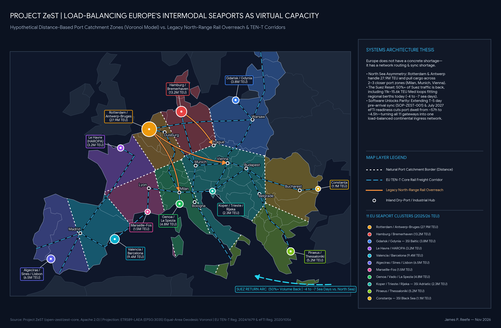

# Continental Network Load-Balancing & Multi-Gateway Synchronization

**Project ZeST (`open-zest/zest-core`) • Architectural Extension (`v0.6.0-continental-parity`)**

---

## 1. Architectural Thesis: Ingress Load-Balancing as Virtual Port Capacity

Europe's intermodal bottleneck is frequently misdiagnosed as a physical concrete shortage at North Range seaports. Viewed as a packet-switched network, the continent suffers from **asymmetric ingress routing and control-plane latency**:

- **Legacy North-Range Overreach:** Rotterdam and Antwerp-Bruges process ~27.9M TEU annually, routinely discharging Asian containers destined for Milan, Munich, Vienna, Prague, or Budapest. Cargo sails past 2 to 4 closer Mediterranean or Adriatic gateways—burning **4 to 7 extra ocean days**—only to ride congested rail corridors 800–1,100 km back south.
- **Why Shippers Accepted the Detour:** Supply chains optimize against **variance (`σ`)** before distance. Historically, North Sea hubs offered deeper digital integration and shuttle frequency, whereas regional gateways suffered **50+ hour** customs, release, and rail-handoff dwells.
- **The 2026–2027 Inflection Point:** With **>50% of Suez transit volume returning**—including **11,000–15,600 TEU neo-Panamax strings** sized to berth directly at regional Mediterranean, Adriatic, and Iberian ports today—vessel bunching at North Sea yards makes single-spine routing unsustainable.

Applying the validated Maasvlakte II **`T-120h` (`T-5` day) Control Plane decoupling** across all **11 European seaport clusters** (plus the UK Channel Tunnel / `ETDA` corridor as Gateway #12) converts regional ports into high-velocity **Layer-2 Cut-Through Switches**, unlocking **10%+ effective European capacity** on existing infrastructure.

---

## 2. Two-Tier Spatial Topology: Seaport Zones ➔ Dry-Port Breakeven

Project ZeST models European freight distribution across two coupled spatial tiers:

1. **Tier 1 — Seaport Voronoi Catchment Zones (Right Ship, Right Port, Right Zone):**
   Matching vessel class (`8,000–16,500 TEU` regional loops vs. `24,000 TEU` North-Range ULCVs) to the geographically nearest deepwater gateway eliminates multi-day ocean detours and cross-continent rail backhauls across Southern Europe, the Three Seas Initiative (3SI: Baltic–Adriatic–Black Sea), and the Western Balkans.
2. **Tier 2 — Inland Dry-Port Granularity & Breakeven Compression:**
   Under legacy port turnaround (`57.39 hours` mean dwell; `1.65` yard digs/box), intermodal rail only beats Over-The-Road (OTR) trucking beyond **`540 km`**. Stripping port dwell down to **`4.43 hours`** (`0.31h` quayside-to-rail cut-through; `0.00` yard digs) collapses the rail-vs.-truck break-even distance to **`195 km`**.
   - Short- and medium-haul rail shuttles (e.g., *Genoa/Vado–Milan*, *La Spezia–Melzo/Bologna*, *Valencia–Madrid/Zaragoza*, *Rotterdam–Venlo*, *Piraeus–Thriasio–Belgrade–Budapest*) become time- and cost-competitive conveyor belts.
   - Each inland dry port projects a **30–50 km drayage halo**; industrial clusters falling outside those halos define Europe's empirical **Intermodal Gap Analysis**.

---

## 3. Bridging the Maritime-to-eFTI Seam Without ERP Tear-Up

A critical regulatory and technical gap sits right at the European quayside:

- **EU Regulation (EU) 2020/1056 (`eFTI`)** mandates Member State authority acceptance of electronic freight transport data starting **9 July 2027** (governed by Implementing Regulations `2024/1942`, `2024/2024`, and `2025/2243`), **but `eFTI` covers strictly inland surface transport** (rail, road, inland waterways) and excludes maritime bills and customs portals.
- **The Boundary Bottleneck:** Maritime electronic Bills of Lading (`ISO 5909` / GSBN, DCSA eBL, and UK *Electronic Trade Documents Act* `ETDA` instruments) terminate at the ship's rail, while `ICS2` / `NCTS` transit clearances sit in separate customs regimes.

### Zero-Tear-Up Thin Federated Abstraction (`openmanifest.v1`)
Rather than requiring shippers, forwarders, or secondary terminals to rip and replace legacy ERP (SAP/Oracle) or TOS platforms, `openmanifest.v1` operates as a **thin federated abstraction layer** wrapping existing COTS SaaS endpoints:

| Lifecycle Timestamp | Control Plane Event | Data Plane Impact |
| :--- | :--- | :--- |
| **`T-120h` (At Sea)** | Bind maritime eBL (`ISO 5909` / DCSA / UK `ETDA`) + `ICS2`/`NCTS` pre-clearance + `UIC` 740m rail wagon slot into cryptographic `openmanifest.v1` header | Predictive resource provisioning of railcars, locomotives, and dry-port crane slots using historical & live flow telemetry |
| **`T=0h` (Quayside)** | Spreader release verified against pre-cleared token; non-compliant boxes routed to bonded quarantine spur (`STN-40Q`) | **`0.31h`** direct STS crane ➔ transfer loop ➔ on-dock rail consist (`0.00` yard stack digs) |
| **`T+4.4h` (Inland Leg)** | Seamless token handoff to certified national `eFTI` Gate UUID for borderless EU & UK-Chunnel rail transit | **`±0.35 day`** corridor variance (`σ`); zero paper holds from Quay to Dry Port |

---

## 4. End-to-End IoT Characterization & Verification

Optimizing node-by-node in operational silos masks systemic corridor bottlenecks. Project ZeST pairs `T-120h` manifest crystallization with **end-to-end IoT container state timestamps** from origin vessel discharge through border sidings to final dry-port gate-out—isolating variance across all 11 European catchment zones and North African / Balkan short-sea ingress corridors.

To run the discrete-event simulation (`SimPy`) and inspect the 6-part interactive telemetry suite locally, see the root [`README.md`](../README.md).
