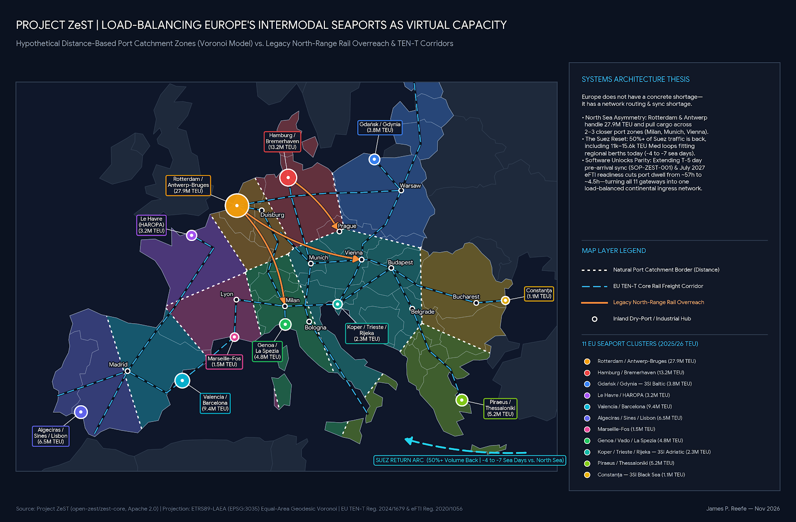

# Part 1: Load-Balancing Europe's Intermodal Seaports as Virtual Capacity

*Series 1 · Part 1 of 6*

For intermodal container freight, Europe does not have a seaport concrete shortage—it has a routing and synchronization problem.

Across Europe’s 11 primary seaport clusters (78.9M TEU), Rotterdam/Antwerp-Bruges (27.9M TEU) and Hamburg/Bremerhaven (13.2M TEU) absorb 52.1% of container volume—pulling cargo from closer Mediterranean, Adriatic, and Baltic gateways into Milan, Munich, Vienna, and Warsaw, resulting in a logistics load imbalance across Europe.

Over the next three weeks, I am sharing concepts from **Project ZeST (Zero-Sort Transport)**—a high-level roadmap enabling regional gateways to provide predictable, pre-cleared ship-to-rail handoffs so shippers can use the port closest to their factories.

The concept features:

* **Continental Load-Balancing:** Routing 11k–15.6k TEU loops into Valencia, La Spezia, Piraeus (Athens), and Gdańsk cuts 4–7 sea days (13–17 round-trip days on Adriatic/Ligurian strings) before a container touches a crane.
* **Decoupling Data from Iron:** Clearing eBL and eFTI (EU 2020/1056) tokens and T1 customs bonds 5–10 days pre-arrival facilitates direct ship-to-rail handoffs.
* **Zero-Concrete Virtual Capacity:** Direct ship-to-rail handoffs cut mean dwell by 92.1% (~57h to ~4.5h), turning 11 regional gateways into one load-balanced continental ingress grid.

Compliance with EU digital mandates for intermodal freight facilitates scalable direct business interfaces to suppliers and customers, applying equally to all industry stakeholders regardless of location. Tracking toward full compliance helps bring logistical parity to all regions across the union.

We don't need a decade for new quay walls—we need better infrastructure utilization enabled by digital business processes today.

*Heading into 2027, what hurts your lead-time reliability more—physical rail capacity, or post-arrival data and customs lag?*

---

### Supporting Resources

* **Interactive 17-Gateway Map:** [European Corridor Reference Map](../../maps/corridor-reference-map.md)
* **Open-Source Simulation & Solvers:** [open-zest/zest-core (Apache 2.0)](https://github.com/open-zest/zest-core)

---

**Series Navigation:** [Part 2: The Suez-to-Gibraltar Arc →](02-suez-gibraltar-arc.md)
