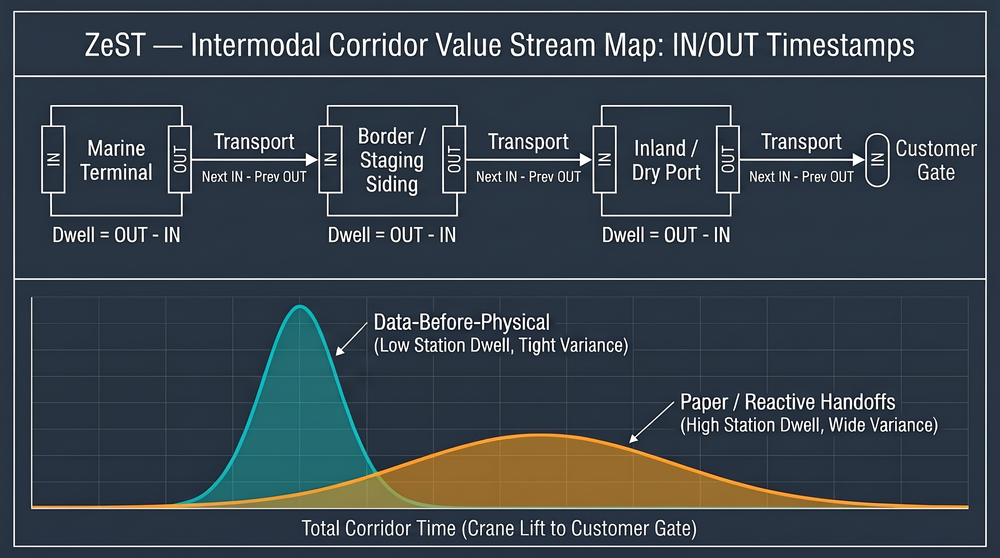

# Part 3: Separating Transport Time from Transition Dwell

*Published November 2026 | Series 1: European Intermodal Corridors & eFTI Alignment*

You cannot fix latency in European intermodal freight—or justify billions in new physical infrastructure—until you separate **transport time** from **transition dwell**. Right now, we debate port expansions and decade-long rail builds without verifying two basic baseline numbers for Europe's seaport-to-rail corridors: **Mean Time to Delivery** and **standard deviation (variance)** from vessel crane lift to customer gate.

During the smart-container session at Intermodal Europe in Rotterdam, I asked the IoT panel: instead of using container telemetry strictly to hunt down individual late boxes or monitor reefers, can we aggregate anonymized timestamps to baseline corridor performance end to end?

**Yes.** IoT experts agree. Using the container as an IoT object to build a timestamp-based process model is technically possible and a good use of the technology.

## Building an Intermodal Value Stream Map

Let's use container IoT to build a Value Stream Map—a process model—on an intermodal corridor. To do it, you need **IN** and **OUT** timestamps at every transition station:

* **Marine Terminal:** Crane discharge (`IN`) → Rail ramp or gate exit (`OUT`)
* **Border / Staging Siding:** Siding arrival (`IN`) → Departure (`OUT`)
* **Inland / Dry Port:** Terminal arrival (`IN`) → Gate out to drayage (`OUT`)
* **Destination:** Customer gate arrival (`IN`)

Capturing `IN` and `OUT` at each node splits every trip into two distinct measurements:

* **Inside the station (`OUT - IN`):** Transition dwell—yard re-handling, customs holds, missing release tokens, and uncoordinated rail slots.
* **Between stations (`Next IN - Previous OUT`):** Pure transport time—actual rail and road transit velocity.

## Pairing Physical Telemetry with the Data Stream

Combining standardized facility geofences from the **Bureau International des Containers (BIC)** with container telemetry and platform capabilities across **Hapag-Lloyd AG**, **Nexxiot**, **Hoopo**, **BoxPlus**, **Bright Moon Digital Solutions**, and **ORBCOMM** makes this baseline achievable without waiting on new concrete.

Better yet, do the same for the data stream associated with the container flow. Now managing the business is possible.

Holistic adoption of EU eFTI mandates can make this kind of study Standard Operating Procedure.

## The Operational Payoff

Once you characterize physical transit limits and identify self-inflicted administrative dwell, you can do targeted cost and latency reduction. And once a port and its rail partners publish tight, verifiable corridor variance:

* **Rail** gets a schedule it can plan around.
* **Drayage** shifts to predictable single-day turns.
* **Shippers** gain the confidence to pull time-sensitive cargo off expensive air freight onto intermodal.

---

**Open Question for 2027:** For the IoT, port, and rail teams building toward 2027, what is the main blocker to running an anonymized IN/OUT corridor baseline today—geofence standardization, data-sharing governance, or getting the first shipper to sponsor a lane?

### Related Resources

* [Europe's Seaport & TEN-T Rail Corridors Reference Map](https://www.google.com/maps/d/view?mid=12sJsaCJ9CQAtialOOIJHQEBrvgnlBn0&usp=sharing)
* [Open-Source Discrete-Event Simulation (`open-zest/zest-core`, Apache 2.0)](https://github.com/open-zest/zest-core)
